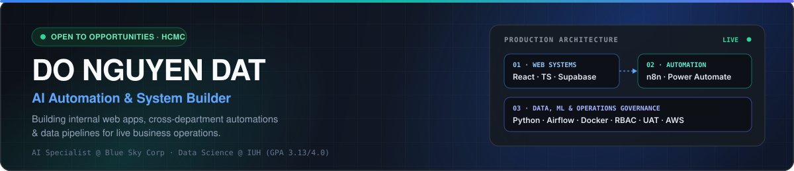
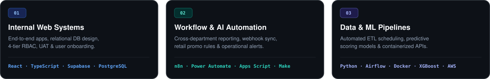

  <picture>
    <source media="(prefers-color-scheme: dark)" srcset="./assets/banner-dark.svg" />
    <source media="(prefers-color-scheme: light)" srcset="./assets/banner-light.svg" />
    
  </picture>

  
  
  
  

---

### What I Build

I bridge **business requirements**, **production software**, and **data pipelines** — currently working as an **AI Specialist / Automation** at [Blue Sky Corporation](https://www.blueskycorp.com.vn/) while completing my **B.Sc. in Data Science** at [IUH](https://iuh.edu.vn/) (`GPA 3.13/4.0`).

  <picture>
    <source media="(prefers-color-scheme: dark)" srcset="./assets/pillars-dark.svg" />
    <source media="(prefers-color-scheme: light)" srcset="./assets/pillars-light.svg" />
    
  </picture>

---

### Selected Projects & Production Systems

| Project / System | Architecture & Impact | Stack | Link |
| :--- | :--- | :--- | :---: |
| **Potential Customer Scoring System** | Automated streaming pipeline `MongoDB → PostgreSQL` scheduled via **Apache Airflow** in **Docker**, serving lead scoring via **Flask** on **AWS**. | `Python` `Airflow` `Docker` `MongoDB` `PostgreSQL` `Flask` `AWS` | [GitHub ↗](https://github.com/dnd26/HE-THONG-CHAM-DIEM-KHACH-HANG-TIEM-NANG) |
| **Credit Scoring Application** *(Lending Club)* | End-to-end credit risk pipeline with **WoE / IV** feature selection benchmarking **LogReg, RF, XGBoost, LightGBM, CatBoost & Deep Learning** (`ROC-AUC`, `Precision`, `Loss`). | `Python` `XGBoost` `LightGBM` `CatBoost` `TensorFlow` `Scikit-learn` | [Kaggle ↗](https://www.kaggle.com/code/skai2002/lending-club-eda) |
| **Retail Activation & Shift Inventory App** *(Enterprise)* | Internal full-stack web app built from scratch with **4-tier RBAC** (`Admin`, `Supervisor`, `QC`, `Field`), promo rules *(gift, sampling, lucky-draw)* & real-time shift stock sync. | `React` `TypeScript` `Tailwind` `Supabase` `PostgreSQL` | *Internal @ Blue Sky* |
| **Cross-Department Automation Suite** *(Enterprise)* | Automated sales revenue reporting, activation workflows & operational notifications replacing manual spreadsheet handoffs across teams. | `n8n` `Power Automate` `Google Apps Script` `Make` `SQL` | *Internal @ Blue Sky* |

---

### Core Tech Stack

| Domain | Technologies & Tools |
| :--- | :--- |
| **Web & Database** |         |
| **Automation & Cloud** |         |
| **AI & Data Science** |        |
| **Operations & QA** | `Requirement Analysis` · `Business Process Mapping` · `RBAC User Governance` · `UAT & Functional Testing` · `Debugging & Live Support` · `User Training` |

---

<b>Experience, Education & Activities</b> <i>(click to expand)</i>

 

#### Work Experience
- **AI Specialist / Automation** — [Blue Sky Corporation – Marketing Activities](https://www.blueskycorp.com.vn/) *(11/2025 – Present · Ho Chi Minh City)*
  - **End-to-End Internal Systems:** Analyzed requirements, designed Supabase/PostgreSQL schemas, and built production internal web apps with React, TypeScript & AI coding tools.
  - **Workflow Automation:** Automated cross-department reporting and Activation/Event processes using `n8n`, `Google Apps Script`, and `Power Automate`.
  - **Retail Operations & RBAC:** Managed full user lifecycle (`Admin`, `Supervisor`, `QC`, store/field staff), configured promotional rules (gift redemption, sampling, lucky-draw), tracked shift inventory, and resolved live data-sync/stock discrepancies.
  - **QA & Enablement:** Authored test cases, ran UAT/debugging, managed deployments, wrote user manuals, and trained internal & store teams.

#### Education & Activities
- **Industrial University of Ho Chi Minh City (IUH)** — B.Sc. in Data Science *(10/2020 – Present · GPA: 3.13/4.0)*
- **Trainee Research Affiliate** — LLD Media *(2025)*
- **VPBank Hackathon** — VPBank *(2025)*
- **Young Science Conference** — [IUH](https://www.facebook.com/ysciuh) *(2024)*

---

  Open to <b>AI Automation</b>, <b>Internal System Engineering</b>, <b>ERP / Product Operations</b> &amp; <b>Data/ML</b> roles — reach me at <a href="mailto:nguyendat103261@gmail.com">nguyendat103261@gmail.com</a>

